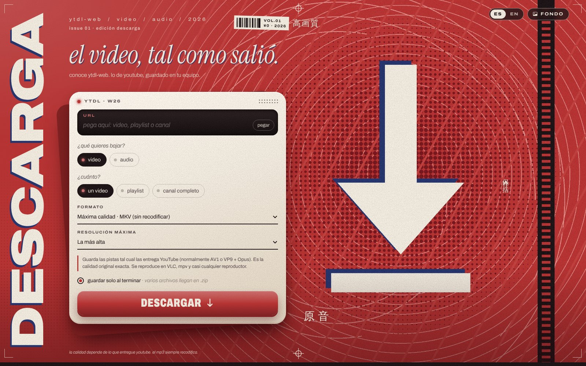
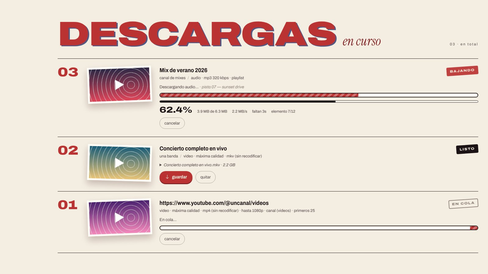
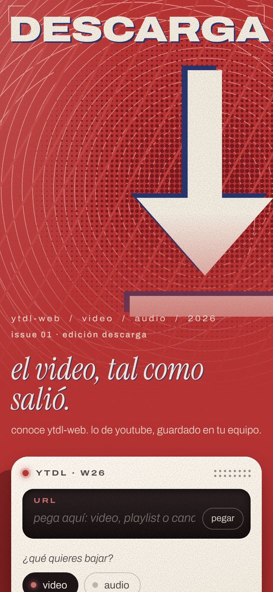
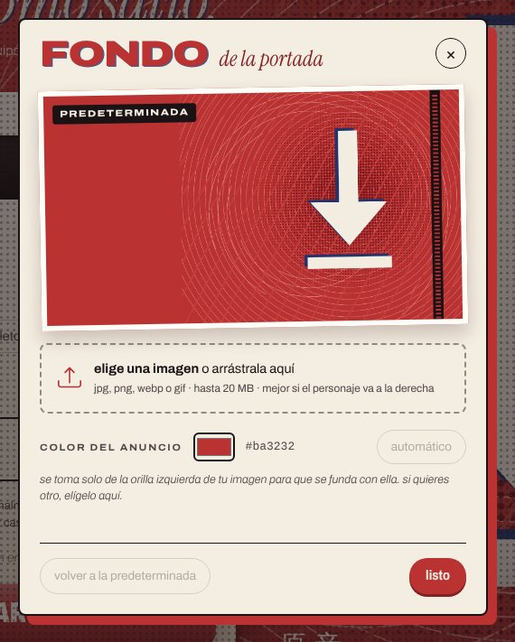

# ytdl-web

[English](README.md) · **Español**

**Descargador web de video y audio de YouTube, en un contenedor.** Pegas una URL, eliges video o audio, y el archivo se guarda solo en tu equipo: video en la calidad original y audio en MP3 o en su pista original sin recodificar. Por dentro usa [yt-dlp](https://github.com/yt-dlp/yt-dlp) y ffmpeg.


> [!NOTE]
> **Proyecto vibe-codeado.** Casi todo el código se escribió conversando con una IA (Claude, de Anthropic): yo dije qué quería, cómo debía verse y qué fallaba, y la IA escribió el código y lo probó. Lo uso a diario y funciona, pero no pasó por una revisión de código formal. Úsalo con criterio, sobre todo si lo expones fuera de tu red.



## ¿Qué es?

Empezó como un script de escritorio en Python que descargaba videos en máxima calidad y dejó de funcionar. Esta es su versión nueva: una app web que corre en Docker, con interfaz de anuncio impreso de revista de los 2000.

- **Un video, una playlist o un canal completo.** Del canal eliges la sección (Videos, Shorts, Directos o Todo) y cuántos bajar, empezando por lo más reciente. Al pegar la URL, la página detecta sola si es canal o playlist.
- **Calidad original.** El video se guarda con las pistas tal como las entrega YouTube (AV1/VP9 + Opus), sin recodificar. El audio sale en MP3 320 kbps con portada y metadatos, o en su pista original.
- **Se guarda solo.** Al terminar, el navegador baja el archivo automáticamente. Si son varios, como en una playlist, llegan en un solo `.zip`.
- **Sin historial.** En cuanto el navegador recibe el archivo, se borra del servidor; al reiniciar, no queda nada.
- **Funciona sin internet.** Fuentes, íconos y estilos vienen incluidos, así que la página abre aunque no haya red. Descargar sí necesita internet, obviamente.
- **Fondo personalizable.** Con el botón **FONDO** subes tu propia imagen y el color de toda la página se adapta a ella.
- **Español e inglés.** El idioma se elige solo según tu navegador y se cambia con el selector **ES · EN** de la esquina.
- **Responsiva.** Se usa igual desde el celular.

<table>
  <tr>
    <td width="62%"></td>
    <td width="38%" rowspan="2" valign="top"></td>
  </tr>
  <tr>
    <td></td>
  </tr>
</table>

## Cómo levantarlo

Solo necesitas **Docker** con **Docker Compose**. Funciona en Linux, en Windows con WSL2 o Docker Desktop, y en macOS.

```bash
git clone https://github.com/Zaporitecua/ytdl-web.git
cd ytdl-web
docker compose up -d --build
```

Abre **http://localhost:8080** y listo.

La primera construcción tarda unos minutos porque instala ffmpeg; las siguientes tardan segundos. Al arrancar, el contenedor actualiza yt-dlp solo, porque YouTube cambia seguido. Si no hay internet, arranca igual con la versión que ya tiene.

### Comandos útiles

```bash
docker compose logs -f ytdl-web      # ver qué está pasando
docker compose restart ytdl-web      # reiniciar (de paso actualiza yt-dlp)
docker compose down                  # detenerlo
git pull && docker compose up -d --build   # actualizar a la última versión del proyecto
```

### Sin Compose

```bash
docker build -t ytdl-web .
docker run -d --name ytdl-web -p 8080:8080 \
  -v ytdl-descargas:/downloads -v ytdl-fondo:/data \
  --restart unless-stopped ytdl-web
```

### Ponerle contraseña

Si lo vas a abrir desde otros equipos de tu red, en `docker-compose.yml` llena `APP_PASSWORD` y la página pedirá usuario (`APP_USER`, por defecto `admin`) y contraseña. **No lo expongas a internet sin contraseña** y, de preferencia, ponlo detrás de un proxy con HTTPS.

## Formatos

**Video**

| Opción | Qué hace |
|---|---|
| Máxima calidad · MKV | Pistas originales (AV1/VP9 + Opus) sin recodificar. Es la calidad exacta de YouTube. |
| Máxima calidad · MP4 | Las mismas pistas, en contenedor MP4. |
| Compatible para edición | H.264 + AAC (normalmente hasta 1080p). Abre en cualquier editor de video. |

**Audio**

| Opción | Qué hace |
|---|---|
| MP3 320 kbps | MP3 a la tasa máxima, con portada y metadatos. |
| MP3 VBR V0 | MP3 variable de máxima calidad, más ligero. |
| Original sin recodificar | La pista tal cual (.opus o .m4a). La única opción que es realmente calidad original. |
| M4A / AAC | AAC; si YouTube ya lo tiene en AAC, se copia sin recodificar. |

> MP3 siempre implica recodificar, porque YouTube no sirve MP3. Convertir a 320 kbps no mejora la fuente (~128–160 kbps en Opus/AAC); solo minimiza la pérdida adicional.

## Imagen de fondo

- Desde la página: botón **FONDO** → sube una JPG, PNG, WebP o GIF. Se valida, se convierte a WebP y se guarda en el volumen `fondo` (`/data`), así que sobrevive a reinicios y reconstrucciones.
- El color del anuncio se toma de la orilla izquierda de la imagen para que se funda con ella. También lo puedes elegir a mano.
- Se ve mejor una imagen horizontal con el personaje o motivo del lado derecho.
- **Cambiar la predeterminada:** pon tu imagen como `app/static/bg.jpg` y reconstruye. Si no existe, se usa `app/static/bg-default.jpg`, el póster que viene con el proyecto. `bg.jpg` está en `.gitignore` para que no subas por accidente imágenes con derechos de autor.

## Configuración

Todo se ajusta con variables de entorno en `docker-compose.yml`:

| Variable | Por defecto | Qué hace |
|---|---|---|
| `MAX_CONCURRENT` | `2` | Descargas simultáneas; las demás esperan en cola. |
| `KEEP_FILES` | `0` | `0`: sin historial, cada descarga se borra del servidor al recibirla y todo se limpia al reiniciar. `1`: se conservan y la lista sobrevive a reinicios. |
| `RETENTION_HOURS` | `24` | Horas antes de borrar lo que nunca se bajó (`0` = nunca). |
| `YTDLP_AUTOUPDATE` | `1` | Actualiza yt-dlp en cada arranque. |
| `ALLOW_PLAYLISTS` | `1` | Permite playlists y canales completos. |
| `APP_USER` / `APP_PASSWORD` | `admin` / vacío | Si `APP_PASSWORD` tiene valor, la página pide usuario y contraseña. |
| `MAX_UPLOAD_MB` | `20` | Tamaño máximo de la imagen de fondo. |
| `COOKIES_FILE` | `/config/cookies.txt` | Cookies opcionales de YouTube (formato Netscape). |
| `FONDO_DIR` | `/data` | Dónde se guarda la imagen de fondo subida. |

## Cuando YouTube falla

1. **Reinicia el contenedor** (`docker compose restart ytdl-web`) para que tome el yt-dlp más reciente. Es lo que arregla el 90 % de los casos.
2. **"Sign in to confirm you're not a bot":** YouTube bloquea mucho las IPs de servidores en la nube. Exporta un `cookies.txt` de tu navegador (por ejemplo, con la extensión *Get cookies.txt LOCALLY*) y descomenta la línea de `cookies.txt` en `docker-compose.yml`.
3. **Revisa el registro:** en la tarjeta de la descarga que falló está "ver registro", o usa `docker compose logs ytdl-web`.

## Cómo está hecho

- **Backend:** Python 3.13 + Flask + gunicorn, con un solo worker a propósito, porque el estado de las descargas vive en memoria. Pillow procesa la imagen de fondo.
- **Descargas:** yt-dlp con ffmpeg (une video y audio, convierte a MP3) y Deno (resuelve los retos de JavaScript de YouTube).
- **Idiomas:** todos los textos están en `app/i18n.py`. Para agregar otro idioma, copia el bloque `"en"`, tradúcelo y añade su código a `LANGS`.
- **Frontend:** HTML, CSS y JavaScript sin frameworks ni build. Fuentes Archivo e Instrument Serif e íconos de Bootstrap, todo incluido en el proyecto.
- Detrás de NGINX en una subruta funciona tal cual, porque todas las rutas de la página son relativas. Para archivos grandes, usa `proxy_buffering off;` y `proxy_read_timeout 300s;`.

```
ytdl-web/
├── app/
│   ├── app.py               # servidor: cola de descargas, archivos, zip, fondo
│   ├── i18n.py              # textos en español e inglés
│   ├── templates/index.html
│   └── static/              # estilos, JS, fondo predeterminado y fuentes/íconos locales
├── docs/                    # capturas de los README (es/ y en/)
├── Dockerfile
├── docker-compose.yml
├── entrypoint.sh            # actualiza yt-dlp al arrancar
└── requirements.txt
```

## Aviso

Esta herramienta es para uso personal. Descarga solo contenido que te pertenezca, que tenga una licencia que lo permita o que tengas permiso de guardar. Descargar contenido de YouTube puede ir en contra de sus Términos de Servicio y de los derechos de autor de quien lo publicó. Cada quien es responsable de lo que descarga.

Las fuentes Archivo e Instrument Serif se distribuyen bajo la SIL Open Font License, y Bootstrap Icons bajo la licencia MIT; sus licencias están junto a cada una en `app/static/vendor/`.
