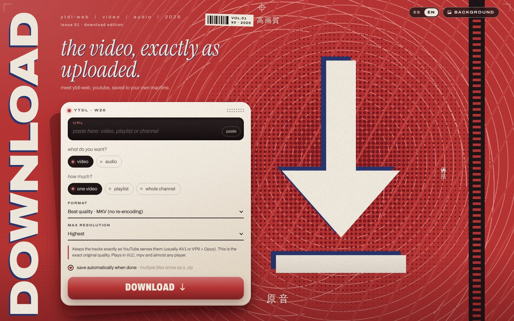
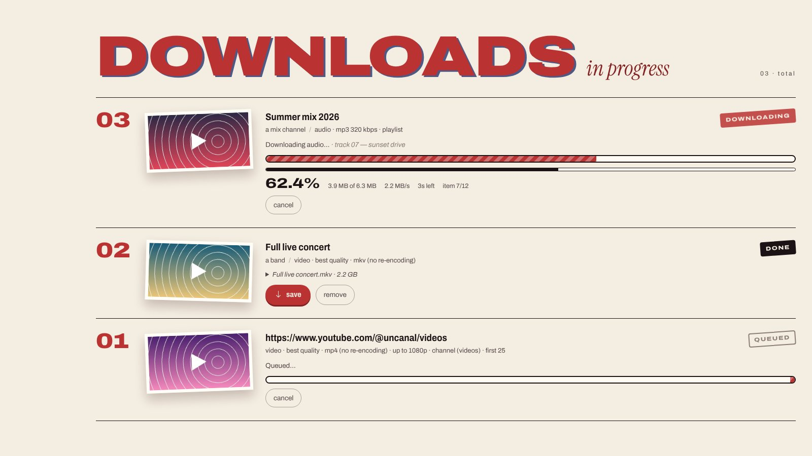
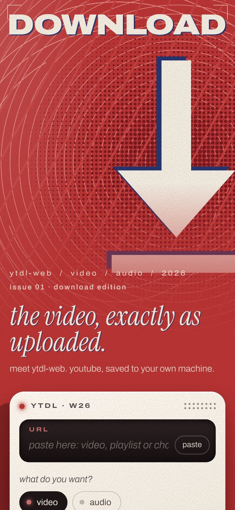
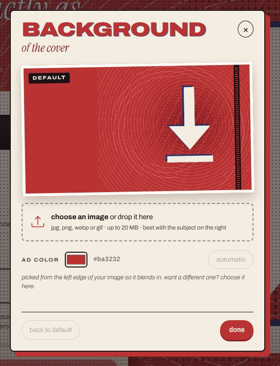

# ytdl-web

**English** · [Español](README.es.md)

**A self-hosted web app to download YouTube video and audio, in a container.** Paste a URL, pick video or audio, and the file saves itself to your computer: video in its original quality, audio as MP3 or as the untouched original track. Under the hood it uses [yt-dlp](https://github.com/yt-dlp/yt-dlp) and ffmpeg.


> [!NOTE]
> **This is a vibe-coded project.** Almost all of the code was written by talking to an AI (Claude, by Anthropic): I described what I wanted, how it should look and what was broken, and the AI wrote and tested the code. I use it every day and it works, but it hasn't gone through a formal code review. Use it with good judgment, especially if you expose it beyond your own network.



## What is it?

It started as a small desktop Python script that downloaded videos in top quality, until it stopped working. This is its new version: a web app that runs in Docker, with an interface styled like a 2000s print magazine ad.

- **One video, a playlist or a whole channel.** For channels you pick the section (Videos, Shorts, Live or All) and how many to grab, newest first. When you paste a URL, the page figures out on its own whether it's a channel or a playlist.
- **Original quality.** Video is saved with the tracks exactly as YouTube serves them (AV1/VP9 + Opus), with no re-encoding. Audio comes out as 320 kbps MP3 with cover art and metadata, or as the original track.
- **Saves itself.** When a download finishes, your browser saves the file automatically. Several files, like a playlist, arrive as a single `.zip`.
- **No history.** As soon as your browser receives a file, it's deleted from the server; after a restart, nothing is left.
- **Works offline.** Fonts, icons and styles are bundled, so the page opens even without internet. Downloading still needs it, of course.
- **Custom background.** The **BACKGROUND** button lets you upload your own image, and the whole page's color adapts to it.
- **English and Spanish.** The language follows your browser and can be switched with the **ES · EN** toggle in the corner.
- **Responsive.** Works just as well on a phone.

<table>
  <tr>
    <td width="62%"></td>
    <td width="38%" rowspan="2" valign="top"></td>
  </tr>
  <tr>
    <td></td>
  </tr>
</table>

## Running it

All you need is **Docker** with **Docker Compose**. It works on Linux, on Windows with WSL2 or Docker Desktop, and on macOS.

```bash
git clone https://github.com/Zaporitecua/ytdl-web.git
cd ytdl-web
docker compose up -d --build
```

Open **http://localhost:8080** and you're done.

The first build takes a few minutes because it installs ffmpeg; later builds take seconds. On startup the container updates yt-dlp by itself, since YouTube changes often. If there's no internet, it starts anyway with the version it already has.

### Useful commands

```bash
docker compose logs -f ytdl-web      # see what's going on
docker compose restart ytdl-web      # restart (also updates yt-dlp)
docker compose down                  # stop it
git pull && docker compose up -d --build   # update to the latest version of the project
```

### Without Compose

```bash
docker build -t ytdl-web .
docker run -d --name ytdl-web -p 8080:8080 \
  -v ytdl-descargas:/downloads -v ytdl-fondo:/data \
  --restart unless-stopped ytdl-web
```

### Adding a password

If you'll open it from other devices on your network, fill in `APP_PASSWORD` in `docker-compose.yml` and the page will ask for a user (`APP_USER`, `admin` by default) and password. **Don't expose it to the internet without a password**, and ideally put it behind a reverse proxy with HTTPS.

## Formats

**Video**

| Option | What it does |
|---|---|
| Best quality · MKV | Original tracks (AV1/VP9 + Opus), no re-encoding. The exact quality YouTube has. |
| Best quality · MP4 | The same tracks, in an MP4 container. |
| Editing-friendly | H.264 + AAC (usually up to 1080p). Opens in any video editor. |

**Audio**

| Option | What it does |
|---|---|
| MP3 320 kbps | MP3 at the maximum bitrate, with cover art and metadata. |
| MP3 VBR V0 | Variable-bitrate MP3 at top quality, smaller files. |
| Original, no re-encoding | The track as-is (.opus or .m4a). The only option that is truly original quality. |
| M4A / AAC | AAC; if YouTube already has it in AAC, it's copied without re-encoding. |

> MP3 always means re-encoding, because YouTube doesn't serve MP3. Converting to 320 kbps doesn't improve the source (~128–160 kbps Opus/AAC); it only minimizes the extra loss.

## Background image

- From the page: **BACKGROUND** button → upload a JPG, PNG, WebP or GIF. It's validated, converted to WebP and stored in the `fondo` volume (`/data`), so it survives restarts and rebuilds.
- The ad color is picked from the left edge of the image so the two blend together. You can also choose it by hand.
- A landscape image with the subject on the right looks best.
- **Changing the default:** put your image at `app/static/bg.jpg` and rebuild. If it doesn't exist, `app/static/bg-default.jpg` (the poster that ships with the project) is used. `bg.jpg` is in `.gitignore` so you don't accidentally publish copyrighted images.

## Configuration

Everything is set with environment variables in `docker-compose.yml`:

| Variable | Default | What it does |
|---|---|---|
| `MAX_CONCURRENT` | `2` | Simultaneous downloads; the rest wait in a queue. |
| `KEEP_FILES` | `0` | `0`: no history; each download is deleted from the server once received, and everything is cleared on restart. `1`: downloads are kept and the list survives restarts. |
| `RETENTION_HOURS` | `24` | Hours before deleting anything that was never downloaded (`0` = never). |
| `YTDLP_AUTOUPDATE` | `1` | Updates yt-dlp on every start. |
| `ALLOW_PLAYLISTS` | `1` | Allows playlists and whole channels. |
| `APP_USER` / `APP_PASSWORD` | `admin` / empty | If `APP_PASSWORD` is set, the page asks for a user and password. |
| `MAX_UPLOAD_MB` | `20` | Maximum size of the background image. |
| `COOKIES_FILE` | `/config/cookies.txt` | Optional YouTube cookies (Netscape format). |
| `FONDO_DIR` | `/data` | Where the uploaded background image is stored. |

## When YouTube breaks

1. **Restart the container** (`docker compose restart ytdl-web`) so it picks up the latest yt-dlp. That fixes 90% of cases.
2. **"Sign in to confirm you're not a bot":** YouTube blocks cloud-server IPs a lot. Export a `cookies.txt` from your browser (for example with the *Get cookies.txt LOCALLY* extension) and uncomment the `cookies.txt` line in `docker-compose.yml`.
3. **Check the log:** the card of the failed download has "view log", or use `docker compose logs ytdl-web`.

## How it's built

- **Backend:** Python 3.13 + Flask + gunicorn, intentionally with a single worker, because download state lives in memory. Pillow processes the background image.
- **Downloads:** yt-dlp with ffmpeg (merges video and audio, converts to MP3) and Deno (solves YouTube's JavaScript challenges).
- **Languages:** all UI text lives in `app/i18n.py`. To add a language, copy the `"en"` block, translate it and add its code to `LANGS`.
- **Frontend:** HTML, CSS and JavaScript with no frameworks and no build step. Archivo and Instrument Serif fonts plus Bootstrap Icons, all bundled with the project.
- It works as-is behind NGINX on a sub-path, since every route on the page is relative. For large files, use `proxy_buffering off;` and `proxy_read_timeout 300s;`.
- Code comments are in Spanish.

```
ytdl-web/
├── app/
│   ├── app.py               # server: download queue, files, zip, background
│   ├── i18n.py              # UI text in Spanish and English
│   ├── templates/index.html
│   └── static/              # styles, JS, default background, bundled fonts/icons
├── docs/                    # README screenshots (en/ and es/)
├── Dockerfile
├── docker-compose.yml
├── entrypoint.sh            # updates yt-dlp on startup
└── requirements.txt
```

## Disclaimer

This tool is meant for personal use. Only download content you own, content whose license allows it, or content you have permission to save. Downloading YouTube content may go against YouTube's Terms of Service and against the copyright of whoever published it. You're responsible for what you download.

The Archivo and Instrument Serif fonts are distributed under the SIL Open Font License, and Bootstrap Icons under the MIT license; their licenses sit next to each of them in `app/static/vendor/`.
